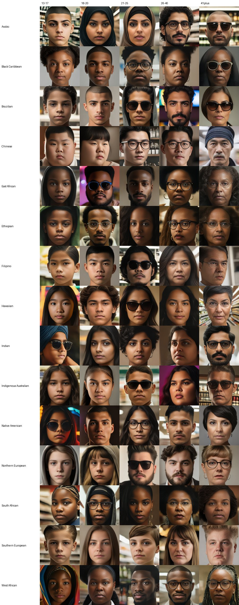
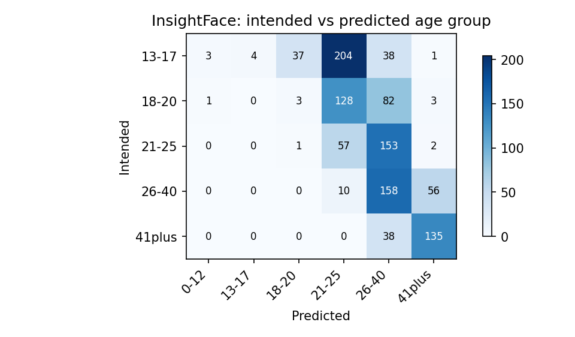

# Synthetic face dataset for age-estimation research

A three-stage pipeline that builds a **synthetic, demographically labelled face dataset** (1,378 images,
15 ethnicity labels, 5 age groups) and evaluates it for **fairness, age accuracy and realism**.
Built for my MSc dissertation (University of Kent) on age verification without collecting real children's faces.



*All faces are synthetic: no real people are depicted. One sample per ethnicity label (rows) and intended age group (columns).*

## Why

Automated age checks for age-restricted goods need age-estimation models, but training data is biased
towards some demographics and collecting faces of minors is ethically fraught. This project asks whether
generative models can supply a balanced, privacy-preserving alternative, and where they fall short.

## Pipeline

```
SDXL seed portraits  ->  AgeTransGAN age transformation  ->  manual curation  ->  CodeFormer restoration  ->  evaluation
 (prompted by             (5 target age groups)               (age-group          (w = 0.7)                 FairFace, InsightFace,
  ethnicity/gender/age)                                        assignment)                                  FID, human ratings
```

| Stage | Tool | Code |
|---|---|---|
| 1. Seed generation | Stable Diffusion XL (50 steps, guidance 7.5) with rule-based prompts | `src/facedata/generation/seed_generator.py` |
| 2. Age transformation | AgeTransGAN | `src/facedata/generation/age_progressor.py` |
| 3. Curation | Flask labelling app (manual) | `tools/curation_app/` |
| 4. Restoration | CodeFormer (fidelity weight 0.7) | `src/facedata/generation/face_restorer.py` |
| 5. Evaluation | FairFace, InsightFace, FID, 24-person rating study | `src/facedata/evaluation/` |

## Results

All numbers below are regenerated from the stored prediction files by `python scripts/make_results.py`
(no model is run). Tables are in [`results/`](results/), figures in [`results/figures/`](results/figures/).

**Fairness: does a face classifier see the intended ethnicity?** FairFace agrees with the intended label for
**69.5%** of detected faces (n = 1,381). It is near-perfect for Indian (1.00), East Asian (0.97) and White (0.90),
good for Black (0.81), and weak for Latino/Hispanic (0.54), Middle Eastern (0.40) and Southeast Asian (0.34).
Part of this is the coarse FairFace taxonomy rather than the images, so read it as a lower bound.

**Age: does an age estimator see the intended age group?** InsightFace places only **32%** of images in the
intended group (n = 1,114 with a detected face), but **70%** within one group. The failure is concentrated in
the youngest groups, which matter most for age verification:

| Intended group | n | Exact | Within one group | Mean error (groups) |
|---|---|---|---|---|
| 13-17 | 287 | 1.4% | 15.3% | +1.95 |
| 18-20 | 217 | 1.4% | 60.4% | +1.38 |
| 21-25 | 213 | 26.8% | 99.1% | +0.73 |
| 26-40 | 224 | 70.5% | 100% | +0.21 |
| 41+ | 173 | 78.0% | 100% | -0.22 |

Positive error means the model predicts an older group than intended. Faces meant to be 13-17 are mostly read
as 21-25 (204 of 287): the model may be a likely weak point, since human raters found them
age-appropriate (below).



**Realism, human study:** 630 ratings on a 1-5 scale. Mean (95% bootstrap CI): realism **3.32** (3.23-3.40),
age appropriateness **3.78** (3.70-3.85), ethnic consistency **3.80** (3.72-3.89).

**Realism, FID** (reported in the dissertation, *not* recomputed here): 141.18 against FairFace and 156.58
against UTKFace. These came from Keras InceptionV3 features, so they are not comparable with FID values from
the standard pytorch-fid weights. The metric itself is implemented and unit-tested in
`src/facedata/evaluation/fid_eval.py`.

## What was and wasn't re-run

This repository is a **clean-up and restructure** of the original work. No image was regenerated and no
model was re-run.

- Re-computed from stored files: every evaluation table and figure, the dataset lineage, the gallery.
- Restructured but **not re-executed** (needs a GPU and the original checkpoints): `generation/` classes.
  The scripts exactly as they ran are kept in [`legacy_as_run/`](legacy_as_run/) for provenance.
- The evaluation code reproduces the dissertation's InsightFace counts exactly (4 / 3 / 158 / 135 correct for
  13-17 / 18-20 / 26-40 / 41+) and its FairFace accuracy (0.70).

## Lineage and known data limitations

[`data/metadata/lineage.csv`](data/metadata/lineage.csv) maps each final image back through the curation steps
(final id -> shuffled id -> consolidated id -> id inside its curation folder, plus the train/test split).
`pytest` checks that the seeded shuffle (`random_state=42`) reproduces this chain exactly.

caveats found while restructuring:

- **Base-image ids are not recoverable.** The curation tool renumbered files in each age-group folder
  (`img001, img002, ...`), so the SDXL seed image behind each aged image cannot be read from filenames.
  Recovering it would need face-identity matching. (SDXL seeds were also not logged.)
- **11 images had `Unknown` gender** because the same renaming step looked up gender by the old filename.
  They were corrected by hand in the final table; `lineage.csv` flags them (`gender_corrected`).
- **Age groups are not perfectly balanced** (13-17: 343, 18-20: 274, 21-25: 273, 26-40: 278, 41+: 210).
- **FairFace mapping:** FairFace predicts one Black class. It cannot tell East African, West African,
  South African, or Ethiopian apart, so those labels (with African and Black Caribbean) are collapsed to
  Black before scoring. The mapping saved in the analysis notebook left the four specific labels out, which
  drops 329 rows and gives 0.66. The reported 0.70 uses the fuller collapse, which is the default here
  (`fairface_eval.NOTEBOOK_MAPPING` keeps the old one for comparison).
- **One face per image is not enforced:** FairFace detected 1,381 faces in 1,378 images, so a few images count more than once.

## Repository layout

```
configs/pipeline.yaml      settings used for the run (steps, guidance, CodeFormer weight, seed)
src/facedata/
  config.py                YAML -> typed config
  dataset/                 age bins, metadata validation, lineage reconstruction
  generation/              SeedGenerator, AgeProgressor, FaceRestorer, pipeline plan
  evaluation/              FairFace, age, FID and human-rating evaluators
scripts/                   build_lineage.py, make_results.py, make_gallery.py
tools/                     curation_app (Flask), human_eval_app (Streamlit)
data/                      metadata, stored model predictions, anonymised ratings
results/                   tables, figures, summary.md
legacy_as_run/             original scripts, untouched
notebooks_original/        original analysis notebooks
tests/                     39 tests, no GPU needed
```

## Reproduce

```bash
pip install -e ".[eval,dev]"
pytest -q                          # 39 tests
python scripts/build_lineage.py    # rebuild data/metadata/lineage.csv
python scripts/make_results.py     # rebuild results/
```

Generating images again needs a GPU plus separate environments for SDXL (`requirements-generation.txt`) and
AgeTransGAN (`requirements-agetransgan.txt`, old PyTorch stack), and a CodeFormer checkout under `third_party/`.
`python -c "from facedata.config import load_config; from facedata.generation.pipeline import describe; print(describe(load_config('configs/pipeline.yaml')))"`
prints the planned stages and the restoration command.

## Licences and credits

This repository's own code is released under the [MIT Licence](LICENSE). That covers `src/`, `scripts/`,
`tests/`, `tools/`, and `configs/`. It does not cover the third-party models or the generated images.

Third-party models keep their own licences and are **not** redistributed here: Stable Diffusion XL
(CreativeML Open RAIL++-M), AgeTransGAN (AvLab-CV), CodeFormer (S-Lab licence, non-commercial), FairFace,
InsightFace. Check each before commercial use.

## Future work

Recover base-image lineage via face-identity matching; automate the manual curation step; add an
intermediate stage that introduces natural imperfections (the domain gap between very clean synthetic faces and
real photographs).
